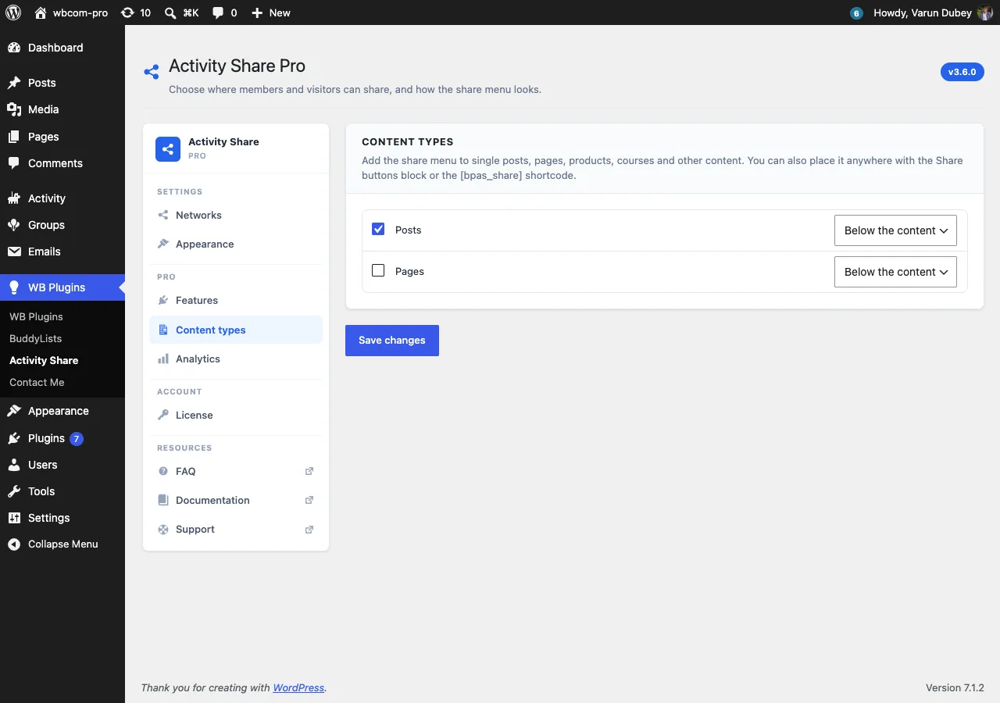

# Content types

> **Pro feature**

**WB Plugins > Activity Share > Content types** - tick a public post type (posts, pages, products, courses...) and choose where the share menu goes: **below the content** (default), **above the content**, or a **floating button**. Default: posts, below.

The list shows every public post type except media files and BuddyPress directory pages. The menu is added on the single post only, not on archives, the front page or BuddyPress screens.

Place the menu anywhere else with the **Share buttons** block, or the `[bpas_share]` shortcode (`[bpas_share id="123"]` for a specific post; leave the `id` out to share the current post). A post that has the block or the shortcode shows the menu only there, so the placement chosen above is skipped for that post.

Repost and Send to a friend show in the menu only for post types ticked here.
