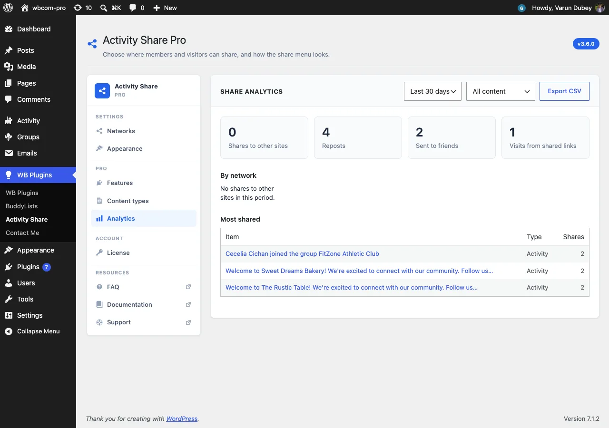

# Share analytics

> **Pro feature**

**WB Plugins > Activity Share > Analytics**

- Totals: shares to other sites, reposts, sends to friends, visits from shared links.
- Shares by network.
- Most shared content, paginated, filterable by activity or posts.
- Period: last 7, 30 or 90 days. **Export CSV** downloads the whole Most shared list for the chosen period and filter, not only the page on screen.

Reposts and sends are always counted. Clicks and visits are counted only when **Share analytics** is on (Features tab). Visitors are counted with a one-way code that changes daily - IP addresses are never stored. Records are kept 12 months and are included in WordPress's personal data export and erase tools (**Tools > Export/Erase Personal Data**).
