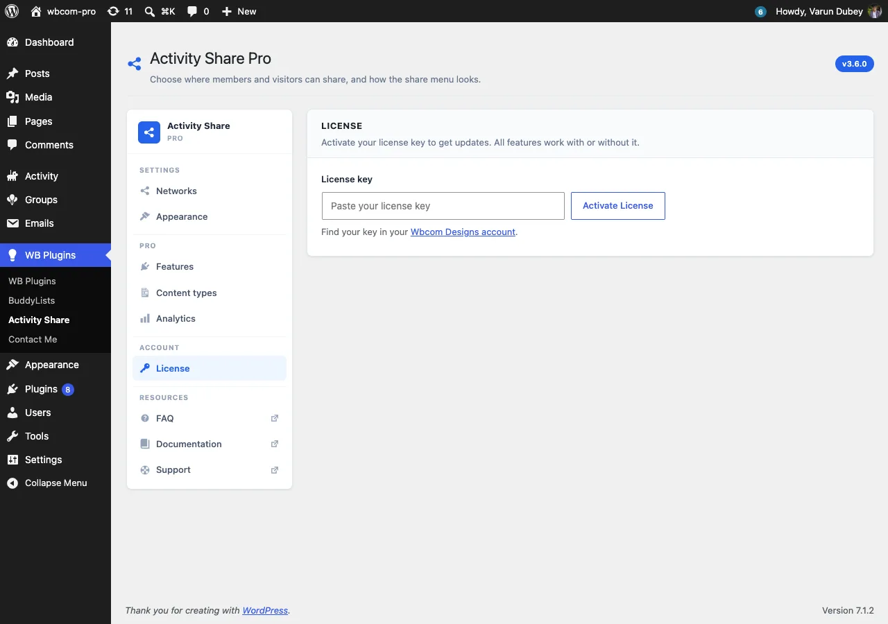

# License

> **Pro feature**

**WB Plugins > Activity Share > License** - paste the key from your Wbcom Designs account and click **Activate License**.

The license only controls whether the plugin receives automatic updates - every Activity Share Pro feature works whether or not a license is active.
