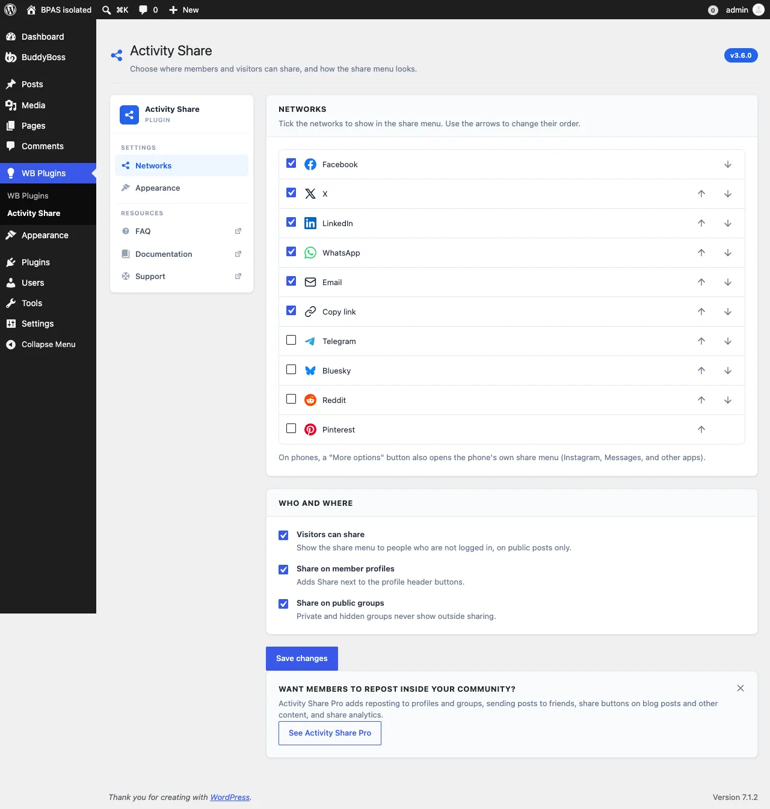

# Networks

**WB Plugins > Activity Share > Networks**

## Networks

Tick the networks to show in the share menu. Use the **up / down arrows** to change their order - this also works with the keyboard. Defaults: Facebook, X, LinkedIn, WhatsApp, Email, Copy link.

On phones a **More options** button also appears automatically. It opens the phone's own share menu, so members can share to Instagram, TikTok, Messages or any installed app.

## Who and where

| Setting | What it does | Default |
|---|---|---|
| Visitors can share | Shows the share menu to people who are not logged in, on public posts only. | On |
| Share member profiles | Adds a Share button next to the profile header buttons. | On |
| Share public groups | Adds a Share button to public group headers. Private and hidden groups never show outside sharing. | On |

Click **Save changes** to apply your changes.
