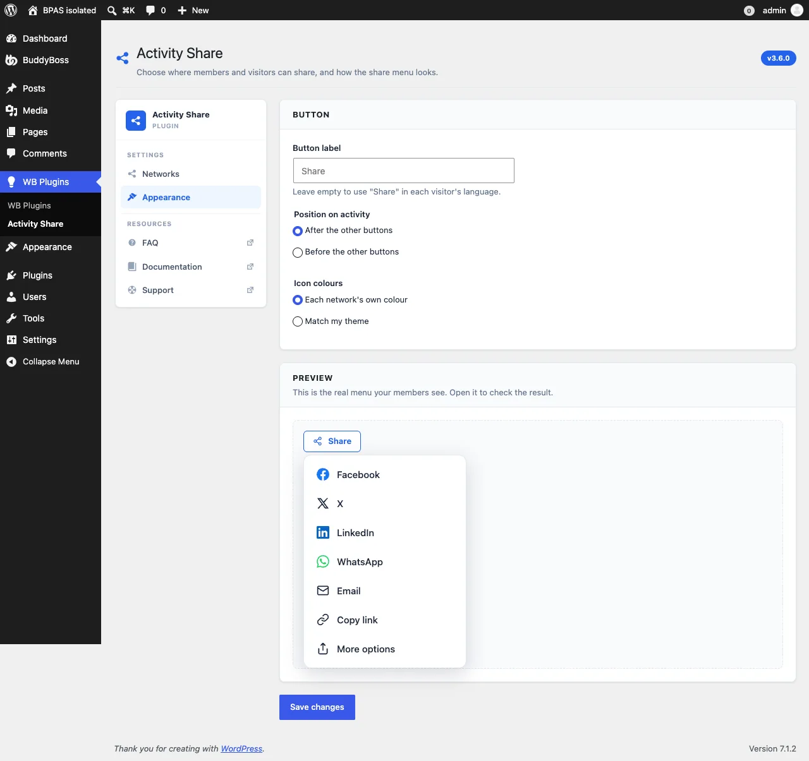

# Appearance

**WB Plugins > Activity Share > Appearance**

| Setting | Options | Default |
|---|---|---|
| Button label | Your own text, or leave empty to use "Share" in each visitor's language. | (empty - "Share") |
| Position on activity | After the other buttons, or before them. Applies to buttons other plugins add to the activity bar too. | After |
| Icon colours | Each network's own brand colour, or your theme's accent colour. | Brand colours |

The **Preview** section is the real share menu, not a mock-up - open it to check your choices before saving.

The menu follows your theme's colours and dark mode automatically (BuddyX, BuddyX Pro, Reign and most popular themes).
